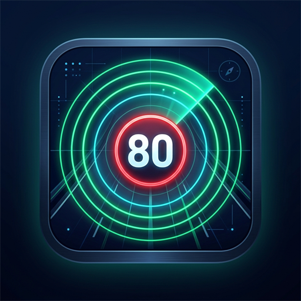

<p align="center">
  
</p>

# 🚗 RadarLite — Monitoramento Automotivo Inteligente de Radares (v1.0)

[-3DDC84?logo=android&logoColor=white)](#)
[](#)
[](#)
[](#)
[](#)

**RadarLite** é um aplicativo Android veicular de alta performance, leve, 100% offline e com interface moderna em **Jetpack Compose**. Projetado especificamente para motoristas e centrais multimídia automotivas, ele funciona como uma camada flutuante inteligente (*overlay*) sobre o Waze, Google Maps ou qualquer outro app de navegação.

---

## 📦 Download do Instalador

Você pode baixar diretamente o instalador compilado da versão 1.0:
- 📲 **[RadarLite.apk](./RadarLite.apk)** (Instalador oficial pronto para Android)

---

## 🌟 Principais Recursos

### 1. 🪟 Janela Flutuante Inteligente (Overlay HUD)
- **Card Dinâmico em 3 Estágios:**
  - 🟢 **Modo Normal:** Alerta discreto quando a velocidade do veículo está dentro do limite da via, exibindo placa oficial de trânsito, distância em tempo real e tipo do radar.
  - 🟡 **Alerta Estático (Atenção Antecipada):** Fundo vermelho sólido e claro que avisa com suavidade que o veículo ultrapassou o limite enquanto ainda há tempo hábil para desaceleração suave.
  - 🔴 **Alerta Agressivo (Redução Urgente):** Pulso visual animado com escala periférica para situações de proximidade crítica com excesso de velocidade.
- **Modo Noturno & Modo HUD:**
  - Card escurecido de alto contraste para não ofuscar o condutor à noite.
  - Modo HUD espelhado horizontalmente para projeção nítida das informações no para-brisa do carro.

### 2. ⚡ Desempenho e Blindagem Anti-Superaquecimento
- **Cache Espacial em RAM (Anti-Throttling):**
  - O aplicativo realiza consultas ao banco Room em raios amplos de 15 km e mantém os radares em memória RAM. O banco só é reconsultado ao percorrer mais de 10 km, economizando 99% de I/O de disco e evitando o superaquecimento do smartphone ou da multimídia.
- **Deduplicação Direcional & Heurística Tipo/Velocidade (Fase 10):**
  - Elimina radares clones/duplicados em memória RAM com base na "impressão digital" (distância < 35m, mesmo limite de velocidade e mesmo tipo de radar).
  - Regra do Campeão: preserva radares direcionais precisos eliminando clones omnidirecionais redundantes, preserva sentidos opostos e não confunde marginais lentas (ex: 40 km/h) coladas em vias expressas rápidas (ex: 80 km/h).
- **Watchdog de Perda de GPS:**
  - Em túneis, garagens subterrâneas ou áreas de sombra, detecta ausência de sinal GPS por mais de 5 segundos, ocultando imediatamente alertas falsos e exibindo sinalizador discreto de busca por satélite.
- **Serviço em Primeiro Plano Blindado:**
  - Foreground Service prioritário com notificação permanente, protegido contra fechamento indevido pelo sistema operacional.

### 3. 🚗 Automação Veicular para Centrais Multimídia & CoolantHUD (Fase 11)
- **Resiliência de Suspensão & Auto-Start Infalível (Fase 11):**
  - **Sobrevivência com `START_STICKY`:** O `RadarOverlayService` opera em modo `START_STICKY`. Se o Android matar o serviço em segundo plano por escassez de memória enquanto a multimídia estiver em suspensão, o sistema recria o serviço automaticamente assim que houver recursos disponíveis.
  - **Estado de Intenção do Usuário (`is_service_intentionally_stopped`):** O aplicativo sabe diferenciar paradas de rotina (desligar o carro) de uma decisão deliberada do usuário. Se o motorista clicar em **STOP** (pelo app ou pelo CoolantHUD), o app respeita e não religa sozinho ao acordar. Se o usuário nunca pediu para parar, o serviço se restabelece de imediato.
  - **Gatilhos de Despertar na Linha ACC:**
    - **`ACTION_POWER_CONNECTED`:** Detecta a ativação da linha de pós-chave / ACC da central multimídia.
    - **`SCREEN_ON`:** Detecta o acendimento da tela ao ligar a ignição sem reboot do sistema.
    - **`BOOT_COMPLETED` & `QUICKBOOT_POWERON`:** Detecta inicialização a frio da multimídia.
  - **Papel Invertido do Bluetooth:** Quando instalado no painel, escuta a conexão do **Smartphone do motorista** (sem restrições a `AUDIO_VIDEO_CAR_AUDIO`), com filtro opcional por MAC ou Nome do aparelho.
- **Controle Remoto & Sincronização de Via Dupla (CoolantHUD / Launchers Customizados):**
  - O aplicativo exporta comandos públicos via `AutostartReceiver` (`android:exported="true"`), permitindo ligar, desligar e sincronizar o status em tempo real com launchers automotivos:
    - **Ligar Overlay:** Dispare um broadcast com a action `"com.jozito412.radarlite.ACTION_START"`.
    - **Desligar Overlay:** Dispare um broadcast com a action `"com.jozito412.radarlite.ACTION_STOP"`.
    - **Solicitar Status (Ping):** Dispare a action `"com.jozito412.radarlite.ACTION_REQUEST_STATE"`. O RadarLite responde instantaneamente transmitindo o status real.
    - **Pulso de Vida Watchdog (Resiliência a Force Stop):** Launchers podem emitir `"com.jozito412.radarlite.ACTION_WATCHDOG_WAKE"` sempre que a tela acender após Deep Sleep prolongado. Se o serviço não foi intencionalmente desligado pelo usuário, ele é restaurado de forma segura e transparente.
    - **Broadcast de Estado (Pong / Eventos):** O RadarLite emite a action `"com.jozito412.radarlite.ACTION_STATE_CHANGED"` com o extra booleano `"is_running"` (`true`/`false`) sempre que o serviço é iniciado, encerrado (inclusive via Bluetooth/Ignição) ou quando solicitado pelo Launcher.
  - Possui trava lógica de concorrência (`startLock`) que evita inicializações duplicadas caso o serviço já esteja em execução.

### 4. 🛡️ Curadoria Manual, Blacklist Híbrida & Backup em TXT (Fases 9, 9.3, 12 & 13)
- **Blacklist Híbrida com Gestos Inteligentes (Fase 9.3 & 12):**
  - **👆 Toque Rápido (Sentido Atual):** Bane apenas o vetor direcional atual de aproximação (`${radarId}_${bearing}`). Aplica um cone de bloqueio de 60º no sentido em que o carro está se deslocando. Ideal para radares que multam apenas a pista oposta ou vias paralelas. Toast informativo com o grau exato: *"Radar banido no vetor ~185º"*.
  - **⏳ Toque Longo / Long Press (Todas as Direções):** Dispara uma resposta háptica (vibração sutil) e bane o radar globalmente (`${radarId}_GLOBAL`). Aplica a marreta global, ignorando o radar de qualquer ângulo de aproximação. Ideal para postes ou lombadas eletrônicas fisicamente desinstalados. Toast: *"Radar banido em TODAS as direções"*.
- **Setas Direcionais no Card de Alerta (Fase 12):**
  - Exibe a fonte da base e um indicador direcional ao vivo na UI:
    - Se o radar possuir direção cadastrada (`direction_deg`), exibe uma seta rotacionada nos graus exatos do banco (Norte = 0º, Leste = 90º, etc.).
    - Se o radar não tiver direção, exibe `• 360°` indicando radar radial omnidirecional.
- **Exportação e Backup da Blacklist em TXT (Fase 13):**
  - Botão **Exportar Blacklist** na tela principal para gerar um arquivo `radarlite_blacklist.txt` compartilhado via Android Intent Chooser (WhatsApp, Bluetooth, Drive, Email, etc.), permitindo migrar a lista de bloqueios facilmente entre telas e centrais multimídia.
- **Botão Gigante de 72dp:**
  - Botão ergonômico com área de toque de `72.dp` e ícone bem visível para curadoria segura em movimento.
- **Gerenciador de Radares Ignorados na Tela Principal:**
  - Painel para consultar todos os radares banidos com indicação clara de bloqueio por sentido ou global, restauração individual ou limpeza completa da blacklist com um toque.

### 5. ⏱️ Fórmula de Alerta por "Tempo de Colisão (TTC) Variável" (Fase 11)
Substituição dos antigos sliders de distância fixa por uma fórmula dinâmica baseada no tempo real que o condutor levará para alcançar o radar:
- **Cálculo Dinâmico:** Converte a velocidade do veículo para m/s (`effectiveSpeed = max(speed, 10 km/h)`) e calcula `timeToCollision = distanceMeters / speedMs`.
- **Curva de Tempo Variável:**
  - 🏙️ **Velocidades Baixas (≤ 60 km/h):** Limite de **9.0 segundos** (evita alertas desnecessariamente longos na cidade).
  - 🚗 **Vias Expressas (61 a 90 km/h):** Limite de **12.0 segundos**.
  - 🛣️ **Rodovias (> 90 km/h):** Limite de **15.0 segundos** (garante frenagem suave e segura em alta velocidade).
- **Alerta Agressivo por TTC:** O alerta passa para Vermelho Piscando se `timeToCollision <= aggressive_alert_time` (padrão 7s) **E** a velocidade atual estiver acima do limite do radar.
- **Configurações Mestre:** Sliders intuitivos para ajuste do **Tempo Base de Aviso** (8s a 30s) e **Tempo de Alerta Agressivo** (3s a 15s).

### 6. 🔄 Atualização Segura (Safe Swap)
- Sincronização direta com a base consolidada dos estados **PR, SC, SP e MS**.
- **Safe Swap:** O download e a conversão dos dados são validados em banco temporário. Se houver falha de rede ou dados corrompidos, a base anterior continua 100% funcional sem interrupções.

---

## 🛠️ Permissões Necessárias

Para o correto funcionamento do aplicativo, conceda as seguintes permissões:
1. **Localização em Segundo Plano:** Escolha a opção *"Permitir o tempo todo"* para que o GPS possa monitorar os radares enquanto outros aplicativos (Waze/Maps) estão em foco.
2. **Sobreposição sobre outros aplicativos:** Permite que a janela flutuante com a placa de velocidade apareça sobre a navegação.
3. **Dispositivos Próximos (Bluetooth Connect):** Necessário a partir do Android 12 para ativar o auto-start ao parear com o rádio do carro.
4. **Notificações:** Mantém o serviço do Android ativo em primeiro plano com prioridade do sistema.

---

## 🏗️ Como Compilar o Projeto

### Pré-requisitos
- JDK 17 ou superior
- Android SDK com compileSdk 37
- Gradle 8.5+

### Linha de Comando
```bash
# Clonar o repositório
git clone https://github.com/jozito412/RadarLite.git
cd RadarLite

# Compilar e gerar o instalador RadarLite.apk
./gradlew assembleDebug

# O APK final é gerado na raiz do projeto:
# ./RadarLite.apk
```

---

## 📱 Tecnologias Utilizadas

- **Linguagem:** Kotlin 2.0+
- **UI Toolkit:** Jetpack Compose & Material 3
- **Banco de Dados:** Room Database (SQLite) com consultas geoespaciais e Safe Swap
- **Serviços:** Android Lifecycle Service & WindowManager Overlay
- **Geolocalização:** Google Play Services Location API
- **Concorrência:** Kotlin Coroutines & StateFlow

---

## 📄 Licença e Créditos

Desenvolvido por **Jozito**.
Dados de radares públicos e abertos consolidados das bases estaduais e comunitárias brasileiras.
